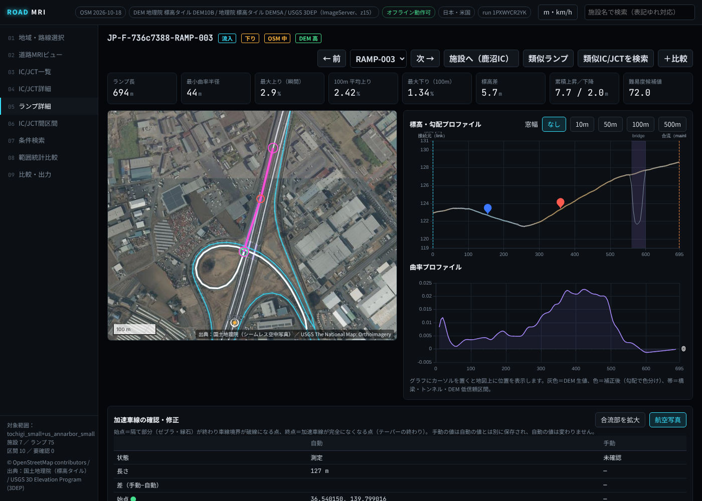
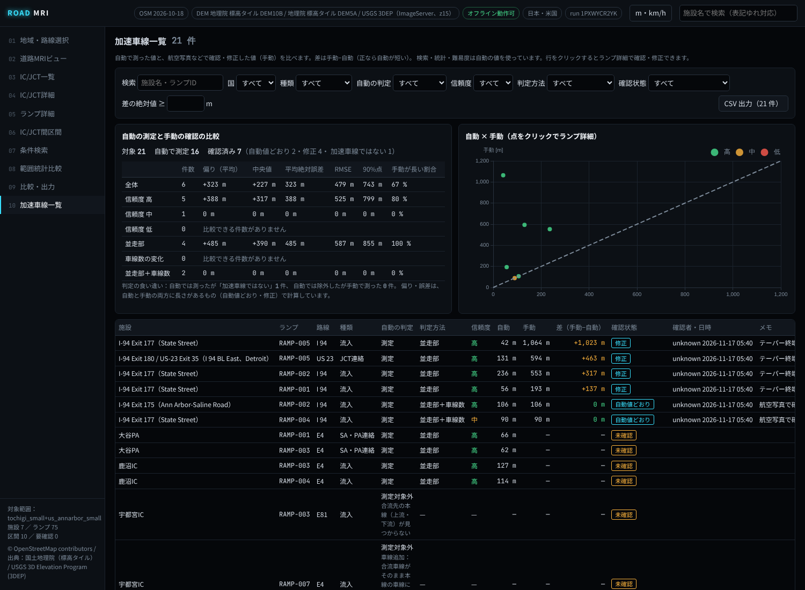

# 加速車線長の算出（2026-11-17）

ADR-0016 の検証。同梱の実データ（宇都宮IC〜鹿沼IC、Ann Arbor の I-94 / US-23）をオフラインで build した結果。

## 判定結果

| 国 | 種類 | 対象 | 測定 | 除外（理由） | 従来の方法で値が出た数 |
| --- | --- | ---: | ---: | --- | ---: |
| 日本 | 流入 | 6 | 3 | 車線追加 1、合流先の本線なし 2（fixture の範囲の端） | 0 |
| 日本 | SA/PA からの合流 | 2 | 2 | － | （対象外） |
| 米国 | 流入 | 8 | 8 | － | 3 |
| 米国 | JCT 連絡路 | 5 | 3 | 付加車線・織り込み 2 | （対象外） |

測定値（m）：日本 114〜136（SA/PA 62〜66）、米国 42〜236。方法は並走部 13 件、並走部と車線数の変化 3 件。
信頼度は高 14、中 1、低 1。

## 確認できたこと・できていないこと

- 地理院のシームレス空中写真に始点・終点を重ねて確認した例（宇都宮IC の流入、127 m）では、始点は跨道橋の直後で
  ランプが本線に隣接する位置、終点は OSM でランプが本線に接続する位置だった。写真の解像度では、加速車線が
  実際に終わる位置（テーパーの終わり）を確定できず、OSM の接続位置より先まで続いている可能性がある。
- OSM は手描きのため、値には数十 m の誤差がありうる。特に「ランプが本線に接続する位置」を終点とする並走型は、
  描いた人が接続点をテーパーの途中に置いていると短く出る。航空写真との照合と手動修正（次の段階）が前提。
- 米国の航空写真（USGS）は z18 のタイルが返らず、今回は照合できなかった。

## テスト

- `tests/unit/test_accel_lane.py`：並走型・車線増減型（`turn:lanes` の有無）・車線追加・付加車線（途中で分岐／戻る点が分岐）・
  別の合流・合流点での車線減少・本線なし・浅い角度（信頼度「低」）・本線の車線数とランプの車線数による「すぐ隣」の幅。
- `tests/integration/test_pipeline.py::test_accel_lane_on_real_fixture`：実データで、合流はすべて判定され、除外は理由付き、
  対象外の種類は空、長さ＝並走部＋増えた車線。
- E2E：ランプ詳細に長さ・方法・信頼度、除外の理由を表示。

## 確認・修正（ADR-0017、2026-11-17）

- 手動の値は `ramp.accel_manual_*` に、自動の値とは別に保存される。保存・確認・取り消し・「加速車線ではない」の
  いずれでも、自動の列が変わらないことを API テストで確認（`test_accel_lane_review_keeps_auto_value_separate`）。
- 再 build 後も手動の値は残り、自動の値は計算し直される（`test_accel_lane_manual_value_survives_rebuild_and_stays_separate`）。
- 道筋から遠い点、終点が始点より上流、自動で測れていないものの「確認」は受け付けない。
- 航空写真：地理院（z18）・USGS（z16）とも、プロキシ経由で取得・保存できることを実サーバーで確認。オフラインでは
  保存済みのタイルだけを返す（API テスト）。
- E2E：地図で始点・終点をクリック → 長さの表示 → 保存 → 手動の値と差の表示 → 取り消し、航空写真の切替と出典。

## 加速車線一覧（ADR-0018、2026-11-17）

上の画面の確認値は、表示を確かめるために一時的な DB へ入れた見本で、実際の精度を表すものではない。

- API テスト（`test_accel_lane_list_summary_and_csv`）：差＝手動−自動、確認状態・差の絶対値などの絞り込み、差による並べ替え、
  要約（偏り・平均絶対誤差・最大・手動が長い割合・信頼度別の件数・判定の食い違い・散布図の点）、CSV（同じ条件の全件、BOM）。
- E2E：サイドバーから開く、確認済みの件数と全体の偏り、散布図、確認状態の絞り込み、差による並べ替え、CSV、行からランプ詳細へ。
- あわせて、空の日時が API で "NaT" という文字列になっていた不具合を修正（null を返す）。
